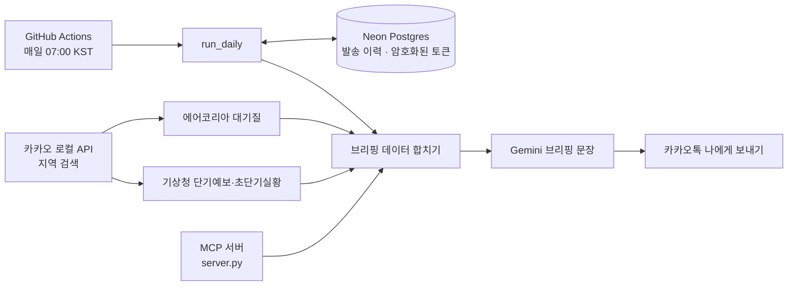

# weather-briefing

기상청·에어코리아 데이터를 모아 AI(Gemini)가 짧은 브리핑 문장을 만들고, 카카오톡 "나에게 보내기"로 매일 아침 발송하는 프로젝트입니다. 같은 기능을 MCP(Model Context Protocol) 서버로도 제공해서, Claude 같은 MCP 지원 AI에서 지역을 바꿔 물어볼 수 있습니다.

- **정기 브리핑**: 매일 07:00(KST)에 GitHub Actions가 자동 실행. PC가 꺼져 있어도 동작
- **수시 브리핑**: MCP 도구로 어느 지역이든 즉시 조회
- **숫자는 API 값만**: 데이터에 없는 숫자가 문장에 들어가면 발송하지 않음. 오류가 있는 브리핑도 발송하지 않음

## 구조



| 위치 | 역할 |
|---|---|
| `weather_mcp/services/` | 날씨, 대기질, 지역 검색, 브리핑, 카카오 발송, 발송 이력, 토큰 저장소 |
| `weather_mcp/server.py` | MCP 도구: `search_location`, `get_weather`, `get_air_quality`, `get_briefing`, `send_briefing_to_kakao` |
| `weather_mcp/run_daily.py` | 매일 발송 진입점 (중복 방지, 이력 기록, 재인증 경고) |
| `.github/workflows/` | `test.yml`(push마다 pytest), `daily.yml`(매일 자동 발송) |

### 설계에서 신경 쓴 점

- **중복 발송 금지**: 하루·지역·채널당 한 줄(UNIQUE) 규칙과 `INSERT ... ON CONFLICT`로 DB가 한 번에 판정합니다. 5개 실행이 동시에 발송권을 잡아도 한 쪽만 성공하는 것을 테스트로 확인했습니다.
- **저장소 교체 가능**: 발송 이력과 토큰 저장소를 인터페이스로 분리하고, 같은 계약 테스트를 SQLite와 Postgres 구현이 모두 통과합니다.
- **토큰은 암호화해서 저장**: 카카오 토큰은 Fernet으로 암호화해 DB에 저장합니다. 평문 토큰은 DB에도 저장소에도 없습니다.
- **키·토큰 노출 방지**: 오류 메시지에는 예외 이름만 남깁니다.

## 설치와 실행 (Windows)

Python 3.14 기준입니다. 프로젝트 루트(`weather-briefing`)에서 실행합니다.

```bat
python -m venv .venv
.venv\Scripts\activate
pip install -r requirements-dev.txt
copy weather_mcp\.env.example weather_mcp\.env
```

`weather_mcp\.env`를 VS Code로 열어 값을 채웁니다. 이 파일은 `.gitignore` 대상이라 커밋되지 않습니다.

| 이름 | 용도 |
|---|---|
| `DATA_GO_KR_API_KEY` | 공공데이터포털 키 (기상청·에어코리아 공용, Decoding 키) |
| `GEMINI_API_KEY` | 브리핑 문장 생성 |
| `KAKAO_REST_API_KEY`, `KAKAO_CLIENT_SECRET` | 카카오 로그인·로컬 API·메시지 |
| `DAILY_LOCATION` | 매일 브리핑 지역 (예: `서울 강남구`) |
| `DATABASE_URL`, `TOKEN_ENCRYPTION_KEY` | 외부 저장소(자동 발송용) |
| `USE_EXTERNAL_STORE` | `1`이면 Postgres 사용. **내 PC에서는 비워 둡니다** |

`TOKEN_ENCRYPTION_KEY`는 아래 명령으로 만듭니다. 잃어버리면 DB의 토큰을 읽을 수 없으니 따로 보관하세요.

```bat
python -c "from cryptography.fernet import Fernet; print(Fernet.generate_key().decode())"
```

### 카카오 토큰 최초 발급

```bat
python -m weather_mcp.try_kakao_auth
```

동의 화면에서 메시지 전송(`talk_message`) 동의가 빠지면 발송이 403으로 실패합니다.

### 브리핑 발송

```bat
python -m weather_mcp.run_daily --dry-run
python -m weather_mcp.run_daily
```

| 옵션 | 동작 |
|---|---|
| `--location 지역` | 지역 지정 (없으면 `DAILY_LOCATION`) |
| `--dry-run` | 문장만 만들어 보여 주고 발송·기록은 하지 않음 |
| `--force` | 오늘 이미 보냈어도 다시 발송 |

### MCP Inspector로 도구 테스트

```bat
npx @modelcontextprotocol/inspector python -m weather_mcp.server
```

## 테스트

```bat
python -m pytest -q
```

외부 DB 테스트는 `DATABASE_URL`이 있을 때만 실행되고, 없으면 건너뜁니다. 테스트는 테마다 임시 스키마를 만들어 쓰고 끝나면 지우므로 실제 발송 이력 표를 건드리지 않습니다.

## 자동 발송 (GitHub Actions)

`daily.yml`이 매일 UTC 22:00(= 07:00 KST)에 `run_daily`를 실행합니다. 저장소 **Settings → Secrets and variables → Actions**에 아래 7개를 등록합니다.

`DATABASE_URL`, `TOKEN_ENCRYPTION_KEY`, `DATA_GO_KR_API_KEY`, `GEMINI_API_KEY`, `KAKAO_REST_API_KEY`, `KAKAO_CLIENT_SECRET`, `DAILY_LOCATION`

Actions 탭 → **daily-briefing** → **Run workflow**로 수동 실행할 수 있습니다. `force`를 켜면 오늘 이미 보냈어도 다시 발송합니다.

### 실패와 만료 알림

- 발송이 실패하면 실행이 빨간 X로 끝나고 GitHub가 메일로 알립니다.
- 카카오 refresh 토큰 만료 14일 전부터, 브리핑 성공 후 하루 한 번 카톡으로 재인증 경고를 보냅니다.

## 운영할 때 알아둘 것

1. **60일 무활동**: 공개 저장소는 60일 동안 활동이 없으면 예약 실행이 꺼질 수 있습니다. 꺼지면 Actions 탭에서 워크플로를 다시 켭니다.
2. **실행 시각**: GitHub cron은 몇 분 늦을 수 있습니다. 07시 정각이 아니라 "07시 전후"로 봅니다.
3. **재인증 절차**: 경고를 받으면 PC에서 `python -m weather_mcp.try_kakao_auth`로 다시 인증한 뒤, 새 토큰을 DB에 올립니다.
   ```bat
   python -m weather_mcp.upload_kakao_tokens --force
   ```
   `--force`는 **재인증 직후에만** 씁니다. 자동 실행 중에는 DB가 토큰의 기준이라, 평소에 쓰면 오래된 로컬 파일로 최신 토큰을 덮어쓸 수 있습니다.
4. **개인정보**: Gemini 무료 구간은 입력이 서비스 개선에 쓰일 수 있어서, 카카오 사용자 정보 같은 개인정보는 보내지 않습니다.

## 진행 단계

- [x] 1단계: MCP 서버 기초
- [x] 2단계: 공공 API 통합 (기상청·에어코리아, 전국 지역 검색)
- [x] 3단계: AI 브리핑 (Gemini)
- [x] 4단계: 카카오톡 연동 (토큰 갱신, 발송)
- [x] 5단계: 운영 환경 (자동 발송, 중복 방지, 외부 저장소, 알림)

### 다음 계획

- 옷차림·우산 등 생활지수와 카톡 문장 개선
- 날짜 지정 날씨 ("내일 해운대 날씨")
- Claude/OpenAI 모델 비교
