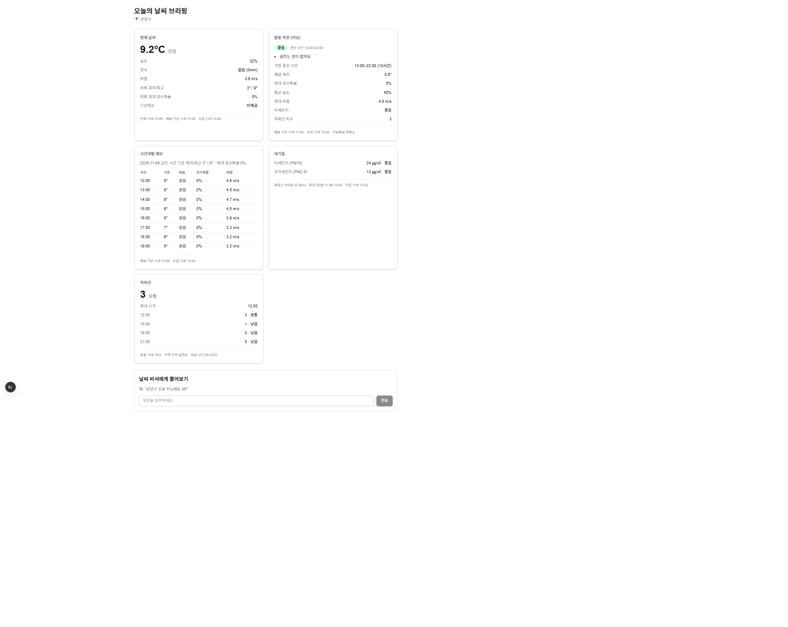

# weather-briefing

[](https://github.com/steamnayo-ux/weather-briefing/actions/workflows/test.yml)

기상청·에어코리아 공공데이터를 MCP 도구와 웹 대시보드로 제공하고, 매일 아침 AI 브리핑을 카카오톡으로 보내는 **개인용 AI 날씨 비서**입니다.

## 핵심 설계 원칙

AI가 날씨를 "그럴듯하게" 말하는 것이 아니라, **실제 데이터만 근거로 말하게** 만드는 데 집중했습니다.

| 원칙 | 구현 |
|---|---|
| 수치는 코드가 고정 | LLM이 만든 문장에서 데이터에 없는 숫자를 검사 |
| 모르는 것은 모른다고 표시 | 특보 조회 기능이 없으므로 `warnings: []`를 "특보 없음"으로 읽지 않음. 응답에는 `special_weather_report: "not_provided"`를 부여하고 화면에는 "미제공"으로 표시 |
| 잘못된 브리핑은 보내지 않음 | 오류 브리핑은 카카오톡 발송 차단, 모호한 지역("중구")은 추측하지 않고 후보 안내 |
| 같은 날 중복 발송 금지 | 발송 이력(날짜+지역+채널) 기반 `claim_send`, 실패 시에만 재시도 |
| 기준 시각·출처 표시 | 모든 응답에 `source`, 관측·예보 시각 포함. 카드마다 집계 기준(하루 전체 / 남은 시간)을 라벨로 구분 |
| 한 곳에서 가공 | MCP, 웹 API가 같은 `tool_output.py`의 `present_tool_result`를 재사용해 응답 모양과 오류 형식을 통일 |

## 아키텍처

```text
Claude 커넥터 ──► remote_server.py ──┐
                                      │
브라우저 ──► Next.js(web/) ──► FastAPI(api.py) ─┤
                                      ├─► tool_output.py(응답 가공) ─► services ─► 기상청 / 에어코리아
카카오톡 ◄── run_daily.py ───────────┘                                   │
        ▲                                                                └─► Neon PostgreSQL (발송 이력·암호화 토큰)
        └── GitHub Actions ◄── cron-job.org (매일 07:07 KST, workflow_dispatch)
```

Next.js는 **서버 컴포넌트와 Route Handler에서만** FastAPI를 호출합니다. 브라우저가 API 서버를 직접 부르지 않으므로 CORS 설정이 필요 없고, `API_BASE_URL`도 브라우저에 노출되지 않습니다.

## 기능

**MCP 도구 (로컬 8개 / 원격 읽기 전용 6개)**

| 도구 | 설명 |
|---|---|
| `search_location` | 전국 지역 검색 (카카오 로컬 API, 모호하면 후보 안내) |
| `get_weather` | 현재 날씨 + 오늘 최저·최고, 강수확률 |
| `get_hourly_forecast` | 날짜·시간 범위별 시간대 예보 |
| `get_air_quality` | PM10·PM2.5 (근접 측정소) |
| `get_uv_index` | 자외선지수 |
| `recommend_activity` | 러닝·산책·외출·빨래 판정과 근거 |
| `get_briefing`, `send_briefing_to_kakao` | AI 브리핑 생성·발송 (로컬 전용) |

**자동 브리핑**: 매일 07:07(KST) 카카오톡 "나에게 보내기". 본문 맨 위에 `📍 지역명` 줄을 표시합니다.

**웹 대시보드 (`web/`)**: 현재 날씨, 시간대별 예보, 대기질, 자외선, 활동 추천 카드 5개.
- 카드마다 `Suspense`를 따로 걸어 느리거나 실패한 카드가 나머지를 막지 않습니다.
- API 서버가 꺼져 있어도 페이지는 유지되고, 실패한 카드 안에서만 오류 문구를 보여 줍니다.

**웹 채팅**: 대시보드 아래 패널에서 자연어로 질문합니다. 브라우저 → Next.js Route Handler(`/api/chat`) → FastAPI `/api/chat` → Gemini → 날씨 도구 순으로 처리하고, 답변과 함께 **사용한 도구 이름**을 표시합니다. 빈 입력은 서버로 보내지 않습니다.

**읽기 전용 REST API**: 날씨, 시간대별 예보, 대기질, UV, 활동 추천, 채팅 엔드포인트와 `/health`를 제공합니다. 실행 후 `/docs`에서 확인할 수 있습니다. 입력 오류(`INVALID_PARAM`)와 서버 오류를 구분해 반환합니다.

## 기술 스택

Python 3.14 · MCP(FastMCP) · FastAPI · httpx · Gemini · Next.js 16 · TypeScript · Tailwind CSS · Neon PostgreSQL · GitHub Actions · Render · cron-job.org · 카카오 API · pytest

## 설치와 실행 (Windows)

```
python -m venv .venv
.venv\Scripts\activate
pip install -r requirements-dev.txt
copy weather_mcp\.env.example weather_mcp\.env
```

`weather_mcp\.env`에 값을 채웁니다. 이 파일은 `.gitignore`로 제외되어 저장소에 올라가지 않습니다.

### 환경변수

| 이름 | 용도 | 필요한 경우 |
|---|---|---|
| `DATA_GO_KR_API_KEY` | 기상청·에어코리아 공공데이터포털 키 (공용) | 필수 |
| `KAKAO_REST_API_KEY` | 카카오 로컬 API(지역 검색), 카카오 로그인 | 필수 |
| `KAKAO_CLIENT_SECRET` | 카카오 토큰 발급·갱신 | 카카오톡 발송 시 |
| `GEMINI_API_KEY` | AI 브리핑 문장 생성, 웹 채팅 | 브리핑·채팅 시 |
| `DAILY_LOCATION` | 매일 브리핑을 받을 지역 | 자동 발송 시 |
| `DATABASE_URL` | 발송 이력·토큰을 저장할 PostgreSQL | 외부 저장소 사용 시 |
| `TOKEN_ENCRYPTION_KEY` | 카카오 토큰 암호화 키 | 외부 저장소 사용 시 |
| `USE_EXTERNAL_STORE` | `1`이면 이력·토큰을 PostgreSQL에 저장 (GitHub Actions용) | 클라우드 실행 시 |
| `REMOTE_API_KEY` | 원격 MCP 서버 접근 키 (32자 이상) | 원격 서버 실행 시 |

로컬 개발에서는 `USE_EXTERNAL_STORE`를 비워 두면 SQLite·토큰 파일을 사용합니다.
원격 접근 키 생성: `python -c "import secrets; print(secrets.token_urlsafe(32))"`

### 웹 대시보드·채팅 실행 (창 2개)

**창 1: API 서버** (프로젝트 루트)

```
.venv\Scripts\activate
uvicorn weather_mcp.api:app --reload --port 8000
```

`http://127.0.0.1:8000/docs`에서 API를 직접 확인할 수 있습니다.

**창 2: 웹 화면** (`web` 폴더)

```
cd web
npm install
npm run dev
```

`web/.env.local`을 만들고 API 서버 주소를 적습니다. 이 파일은 `web/.gitignore`의 `.env*`로 제외됩니다.

```
API_BASE_URL=http://127.0.0.1:8000
```

브라우저에서 `http://localhost:3000`을 엽니다. 배포 전 점검은 `npm run build`입니다.

### MCP·테스트

```
:: MCP Inspector로 확인
npx @modelcontextprotocol/inspector python -m weather_mcp.server

:: 테스트
python -m pytest weather_mcp/tests
```

## 테스트

pytest 444개 통과(1개 건너뜀), push마다 GitHub Actions에서 자동 실행됩니다. 읽기 전용 API(입력 오류 분류, 응답 형식)도 같은 테스트에 포함됩니다. 외부 API와 카카오 호출은 테스트에서 차단·가짜로 대체하고, 현재 시각에 의존하는 코드는 시계를 고정해 검증합니다.

## 사용 범위와 주의

- 개인용으로 설계했고 로그인·다중 사용자는 지원하지 않습니다. Redis, Docker, 카카오 챗봇도 범위에서 제외했습니다.
- 웹 채팅은 Gemini 호출 비용이 있어 **로컬 전용**이며 공개 배포하지 않습니다.
- API 키, 카카오 토큰, 원격 커넥터 URL의 `?key=`는 저장소·채팅·스크린샷에 올리지 않습니다.
- 지역은 구 단위로 입력해야 정확합니다 ("서울"처럼 시 단위는 대표 좌표를 씁니다).
- 기상특보는 조회하지 않습니다. 응답과 화면 모두 "미제공"으로 표시하며 "특보 없음"으로 말하지 않습니다.

## 알려진 한계와 다음 단계

| 항목 | 내용 |
|---|---|
| 카드 집계 기준 | 현재 날씨 카드의 최저·최고·강수확률은 하루 전체, 시간대별 카드는 조회 시점 이후(남은 시간) 기준이라 값이 다를 수 있음. 카드에 기준을 표시 |
| LLM 문장의 한계 | 도구 설명으로 "응답에 없는 말은 덧붙이지 않기"를 지시하지만 모델에게 하는 부탁이라 완전히 막지 못함. 수치는 코드가 고정하나 조언 문장(예: 활동 시간의 길이 평가)이 가끔 덧붙을 수 있음 |
| 지역 선택 | 대시보드는 지역(분당구)과 활동(러닝)이 고정. 채팅에서는 말로 지역을 바꿀 수 있음. 지역 입력 UI와 모호 지역 후보 표시는 다음 단계 |
| 테스트와 운영 DB | 테스트와 운영이 같은 DB를 써서 발송 시간대(07:00~08:30)에는 전체 테스트를 돌리지 않음. 테스트 전용 DB 브랜치 분리는 다음 단계 |
| 악천후 검증 | 비·미세먼지가 나쁜 날의 활동 추천 문구 점검은 해당 날씨에만 가능해 추후 확인 |

## 개발 단계

| 단계 | 내용 | 상태 |
|---|---|---|
| 1~2 | MCP 서버, 기상청·에어코리아 연동 | 완료 |
| 3 | Gemini 브리핑, 숫자 검증 | 완료 |
| 4 | 카카오톡 발송, 토큰 갱신 | 완료 |
| 5 | 자동 발송, 이력·중복 방지, 원격 MCP 배포 | 완료 |
| 확장 A | README 1차 | 완료 |
| 확장 B | FastAPI 읽기 전용 API | 완료 |
| 확장 C | Next.js 대시보드(카드 5개) | 완료 |
| 확장 D | 웹 채팅 | 완료 |
| 확장 E | CI·README 2차 | 완료 |

## 스크린샷

